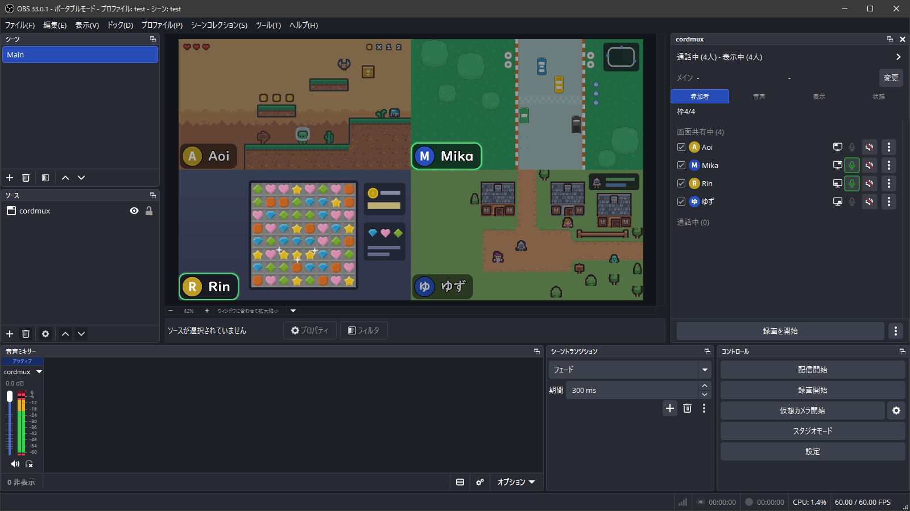

[日本語](README.md)

# cordmux

cordmux is an OBS Studio plugin that brings the screen shares and voices of a Discord call into OBS. It lays out the call's screen shares on the canvas in four slots, and sends their voices and screen share audio to your stream too. There's no need to capture the Discord window.

[Installation](guide/en.md#installation) · [Usage](guide/en.md#using-cordmux) · [Troubleshooting](guide/en.md#troubleshooting)

## Features

- Shows screen shares in slots that split the canvas into four. You pick who appears in the dock, or let cordmux add people automatically when they start sharing their screen.
- Lets you set the volume and mute of each person's voice and screen share audio. You add only one cordmux source to a scene.
- Shows a name label on each slot, and makes the name label of the person who's speaking glow.
- Can show one person's screen share full screen for a while.
- Records each person's screen share and voice to separate files, independently of OBS recording.

> [!TIP]
> When you watch a four-panel stream on YouTube, the Chrome extension [Quad Zoom for YouTube](https://chromewebstore.google.com/detail/quad-zoom-for-youtube/lkklmgeamolillcckodikbbaipaoicjn) lets you zoom into just the panel you want to see.

## Limitations

- cordmux doesn't bring in camera video.
- OBS and Vesktop must run on the same PC.

## Requirements

- Windows 11, x64. Windows on Arm isn't supported.
- OBS Studio 33 or later, x64.
- [Vesktop](https://vesktop.dev/), an app for using Discord that's separate from the official Discord app. The portable version of Vesktop isn't supported.
- If you join calls in the official Discord app: a second Discord account that joins the call in Vesktop.

Other people in the call don't need to install or set up anything.

## Installation

Download `cordmux-<version>.zip` from [Releases](https://github.com/eoforgu0/cordmux/releases), and install it by following the [installation steps](guide/en.md#installation). The same guide is in the zip file as `README-en.txt`.

Installing cordmux switches the Vencord that Vesktop loads (Vencord is a system for adding plugins to Vesktop) to the one bundled with cordmux. Uninstalling cordmux switches it back.

## Getting Help

See "[Troubleshooting](guide/en.md#troubleshooting)" in the guide. To report a bug or a security vulnerability, read [SUPPORT.md](SUPPORT.md).

## Compatibility

cordmux may stop working when OBS, Vesktop, or Discord is updated.

## Development

[CONTRIBUTING.md](CONTRIBUTING.md) explains how to build and test cordmux. It's written in Japanese, as are the code comments and the other developer documents.

## License

The code of cordmux is licensed under the [Apache License 2.0](LICENSE).

The distribution zip file includes GPL software such as Vencord and FFmpeg, so for the zip file as a whole, the corresponding source code is offered as those licenses require. [dist/ソースコードの入手先.txt](dist/ソースコードの入手先.txt) (which also has English lines) lists the license of each bundled component and where to get its source code. The license texts are in [dist/licenses](dist/licenses).
