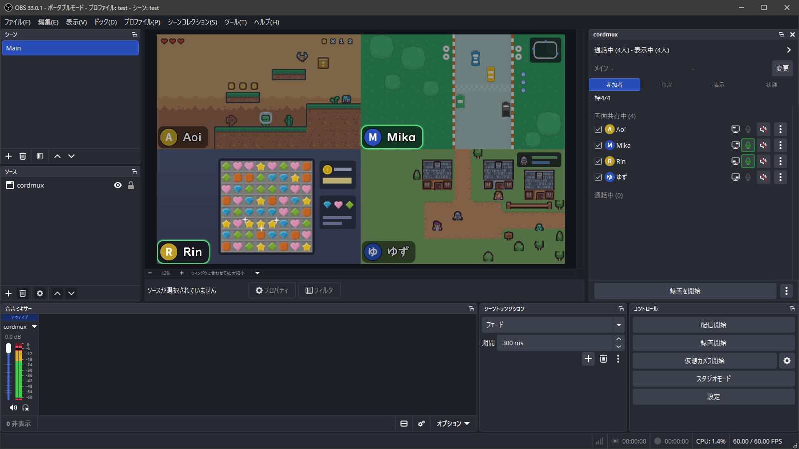

[English](README.en.md)

# cordmux

cordmux は、Discord の通話の画面共有と声を OBS Studio に取り込むプラグインです。通話の参加者の画面共有をキャンバスに 4 分割で並べ、声と画面共有の音声も一緒に配信に流せます。Discord のウィンドウをキャプチャする必要はありません。

[インストール](guide/ja.md#インストール) ・ [使い方](guide/ja.md#使い方) ・ [困ったとき](guide/ja.md#困ったとき)

## できること

- 画面共有を、キャンバスを 4 等分した枠に並べて表示します。並べる人はドックで選びます。画面共有を始めた人を自動で並べることもできます。
- 声と画面共有の音声の音量とミュートを、参加者ごとに調整できます。シーンには cordmux のソースを 1 つ追加するだけです。
- 名前ラベルを表示し、話している人の名前ラベルを光らせます。
- 1 人の画面共有を、一時的に全画面で映せます。
- 画面共有と声を、OBS の録画とは別に、参加者ごとのファイルに録画できます。

> [!TIP]
> 4 画面の配信を YouTube で見るときは、見たい 1 画面だけを拡大できる Chrome 拡張「[Quad Zoom for YouTube](https://chromewebstore.google.com/detail/quad-zoom-for-youtube/lkklmgeamolillcckodikbbaipaoicjn)」も便利です。

## できないこと

- カメラの映像は取り込みません。
- OBS と Vesktop を別々の PC で動かす構成には対応していません。

## 必要なもの

- Windows 11 の x64 版。Windows on Arm には対応していません。
- OBS Studio 33 以降の x64 版。
- [Vesktop](https://vesktop.dev/) (公式の Discord アプリとは別の、Discord を使うためのアプリ)。ポータブル版の Vesktop では使えません。
- 公式の Discord アプリで通話に参加する場合は、Vesktop で通話に参加させる 2 つ目の Discord アカウント。

通話のほかの参加者は、インストールも設定も不要です。

## インストール

[Releases](https://github.com/eoforgu0/cordmux/releases) から `cordmux-<バージョン>.zip` をダウンロードし、[インストールの手順](guide/ja.md#インストール)のとおりに入れます。同じ手順書は、zip の中にも `はじめに.txt` として入っています。

インストールすると、Vesktop が読み込む Vencord (Vesktop にプラグインを追加するための仕組み) が、cordmux に同梱のものに切り替わります。cordmux をアンインストールすると元に戻ります。

## 困ったとき

手順書の「[困ったとき](guide/ja.md#困ったとき)」を見てください。不具合や脆弱性の報告については、[SUPPORT.md](SUPPORT.md) を読んでください。

## 互換性

OBS、Vesktop、Discord が更新されると、cordmux が動かなくなることがあります。

## 開発

ビルドとテストの方法は [CONTRIBUTING.md](CONTRIBUTING.md) にあります。

## ライセンス

cordmux のコードのライセンスは [Apache License 2.0](LICENSE) です。

配布用の zip には、Vencord や FFmpeg などの GPL のソフトウェアが入っているため、zip に入っているものすべてについて、それらのライセンスに従って、対応するソースコードを提供しています。同梱したソフトウェアごとのライセンスとソースコードの入手先は [dist/ソースコードの入手先.txt](dist/ソースコードの入手先.txt) に、ライセンスの本文は [dist/licenses](dist/licenses) にあります。
